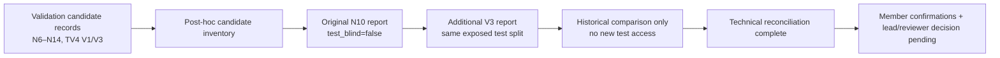

# N10 reconciliation — historical evidence audit

**Status: `CLOSED — LIMITED HISTORICAL ACCEPTANCE`.** User reports that the group confirms N10. This closes only the historical, non-blind evaluation; no test was reopened.

## Existing batch scope

`tv4_n10_freeze_manifest.json` and `tv4_n10_locked_test_report.json` record a one-shot evaluation with `test_blind: false`. The manifest freezes seven TV4 single-model candidates, the TV2 `EXP-N6-C-calibrated` reference (seed 42), three TV4-only ensembles, and two TV2+TV4 cross-member ensembles. It includes TV4 seeds 42/43/44 and the TV2 reference configuration, run ID, validation threshold, and data hashes.

This proves coverage of TV4 and one TV2 reference only. It does not establish that TV1 and TV3 candidates were evaluated, that all four members signed off on the candidate list/protocol, or that the result is the approved team-wide batch. The existing report must remain historical evidence, not a blind test or a newly-run group result.

## N14 and access decision

**N14: COMPLETE — validation-only PhoBERT learning-rate comparison.** N2 results over seeds 42/123/2026: `1e-5` Macro-F1 `0.793272 ± 0.002131`, `3e-5` `0.800336 ± 0.004193`; N13 default `2e-5` baseline `0.801469 ± 0.003773`. Paired mean deltas vs N13 baseline: `-0.008197` (`1e-5`) and `-0.001133` (`3e-5`); neither alternate LR improves the three-seed mean, so no candidate was promoted. All runs used PhoBERT revision `01daacda68afe13d83023d16ec647239e344a1e6`, PyVi `0.1.1`, Transformers `4.57.6`; detailed run lineage and raw validation metrics are in `docs/experiments/phobert_extra_val.csv`. One initial `3e-5`/seed-42 run ended at the 3600s command timeout and was marked `FAILED`; successful retry `5bea48668cfa462e9206a188415e2c96` is used. Validation only; do not append these runs to the historical locked-test batch.

The shared runner hard-codes MLflow experiment/run labels as N13; N14 configs isolate the six completed runs in `models/N14-phobert/mlruns`, and `docs/experiments/phobert_extra_val.csv` maps each N14 setting to its config and run ID. Reported metrics are raw validation metrics at the default 0.50 decision boundary; no extra calibration or threshold tuning was performed.

**No further locked-test access.** No evidence in the current plan/checklists authorizes another access. Any later test access would be a separate, explicitly disclosed evaluation, not a continuation of this N10 batch.

## Group-level disposition

The validation inventory and historical metrics have now been reconciled below, including the N6 three-seed rerun artifacts. This is a post-hoc record, not a pre-test freeze manifest; it cannot retroactively establish a single all-team freeze or blind test.

The user reported that the group confirms N10; accordingly, record `CLOSED — LIMITED HISTORICAL ACCEPTANCE`, not blind-test `PASS` or full `EXPERIMENTALLY VALIDATED`. No individual member statements were supplied, so this record attributes approval only to the user's group-level report. No further test access is needed or authorized.

## Audit trail

- Repository baseline reviewed: `f357a44fb33f419009795e7f7df83a4b242ac521`.
- Initial N10 reconciliation method: read-only inspection of N8/N9 summaries, current task/checklist records, and the existing TV4 N10 manifest/report; no test-data access.
- N14 run evidence: six official N2 train/validation runs, two learning rates (`1e-5`, `3e-5`) × seeds `[42, 123, 2026]`; train SHA `097b32bea731bf1a4771a8485155d339a96027d2819fe8a38aa2c9d2e2f32a73`, validation SHA `4c33430a520818078aef6bcc34b3e2573873445dc7040c5729313e11bb60197a`; no test file was opened.
- Verification: `.venv/Scripts/python.exe -m pytest tests/test_n13_phobert.py -q` → `4 passed`; `docs/experiments/phobert_extra_val.csv` was checked against all six MLflow metrics/data hashes and the interrupted run's FAILED state.
- Additional read-only branch audit: `origin/tam` (`dfb9238`), `origin/feature/svm` (`096b815`), `origin/feature/tv3-scratch-pipeline` (`2f28246`), `origin/TheAnh` (`a33c10a`), and `origin/master` (`d767390`). Member checklists still show N10 pending for TV1/TV2/TV3; TV4 records its completed historical batch. No explicit all-member N10 sign-off was found in those snapshots.
- Owners with explicit N10 sign-off in the inspected records: none evidenced for the full team.

## Update after pulling `origin/master` at `9f96a4d`

- The pulled commit adds the TV4 V3 report and log, which disclose additional historical metrics on the same test split (`test_blind: false`). This is additional reported exposure, not a newly authorized team-wide N10 batch. No `test.parquet` or test prediction artifacts were opened in this update; the committed reports were read only, and their test metrics were not used to select candidates.
- The V3 log states that calibration/ensemble fitting used `Val-5Fold-OOF` after the planned `Train-OOF` work was stopped. This is a documented protocol deviation; it does not supply the missing all-member candidate-scope decision or sign-offs.
- **N10 technical reconciliation completed (2026-11-24):** incorporated the N6 rerun reports/artifact paths, audited the validation candidate families, and consolidated 23 historically test-reported entries from the original N10 and V3 reports. This remains a post-hoc summary, not a new evaluation or blind test. Team-wide closure is still blocked on sign-off.
- Verification evidence: all five N6 rerun directories referenced by this reconciliation exist; the historical aggregate reports, comparison table, candidate inventory, and unchecked sign-off boxes were reviewed. No model was trained and no test dataset/prediction file was opened.

## Validation candidate inventory — group review

**Status: `TECHNICAL RECONCILIATION COMPLETE; GROUP SIGN-OFF PENDING`.** This post-hoc inventory uses existing validation records, not a pre-test freeze manifest, and does not select a production model.

**Selection rule:** raw validation Macro-F1 is the candidate-ranking metric. N8 calibration/threshold results are inference diagnostics fit/evaluated on the same validation set and are not independent ranking evidence. N9 contains controlled validation ablations, not 63 new final candidates. Shared N2/N4 validation SHA-256: `4c33430a520818078aef6bcc34b3e2573873445d460c5729313e11bb60197a`.

| Candidate family | Complete validation inventory | Validation evidence / artifact lineage | Historical test coverage |
|---|---|---|---|
| N6 Logistic Regression | N6-LR-A/B/C/D raw; N6-LR-D calibrated inference variant; seeds `[42, 43, 44]`. Raw N6-LR-D is selected by validation Macro-F1 `0.790095`; calibrated D diagnostics are `0.7738 @0.50` and `0.7903 @0.37`. | `docs/TV1_N6_REPORT.md`; new artifacts `models/baselines/N6-LR-run-ea238c630a2f41b4b5be6b58edf4cdcd/` and `models/baselines/N6-LR-run-9a9124eff43b480fb679b22d04130595/`; config, metrics, predictions, hashes, metadata and `.joblib` per seed. | No LR candidate in the historical N10/V3 test reports. |
| N6 LinearSVC | Raw A/B/C/D-balanced and D-no-class-weight; C calibrated inference variant; seeds `[42, 43, 44]`. Raw Macro-F1: A `0.7768`, B `0.7875`, C `0.7892`, D-balanced `0.7833`, D-none `0.7741`; C calibrated `0.7836 @0.50`. | `docs/TV2_N6_REPORT.md`; new artifacts `models/baselines/N6-run-f975f2c166c94e2c8cb9ec5ba19515b2/`, `models/baselines/N6-run-ca9298076882486d8c5f70c802071d5c/`, `models/baselines/N6-run-995fc60769a843e59705d945a6a44582/`. Raw SVM outputs are margins, not probabilities. | Only historical `EXP-N6-C-calibrated` seed-42 reference; no other raw SVM variant was in the old N10 batch. |
| N5 FastText | Official train-only FastText, seeds `[42, 123, 2026]`; validation Macro-F1 mean `0.622218`. | `docs/todos/TV3.md`; `models/baselines/N5-run-4cef5024bbdb437296384e56b471e20b/`; `artifacts/N8/fasttext/`. | None. |
| N7 recurrent / N9 initialization | LSTM `0.655499`, BiLSTM `0.649511`, BiLSTM+Attention `0.611734`; N9 random-init vs FastText-init BiLSTM+Attention `0.584855` vs `0.682165` (controlled validation ablation). | `docs/todos/TV3.md`; `artifacts/N8/recurrent/`; `artifacts/N9/README.md`; `artifacts/N9/ablation_val.csv`. | None. |
| TV4 V1 CNN/Char-CNN/hybrid | All 18 configs × 3 seeds: `CNN-01`, `CNN-02`, `CNN-03a`, `CNN-03b`, `CNN-04a`, `CNN-04b`, `CNN-01-WD`, `CNN-IMB-CW`, `CNN-IMB-FOCAL`, `CNN-IMB-SAMPLER`, `CNN-AUG-N4`, `CHAR-01`, `CHAR-02`, `CHAR-03`, `HYBRID-01`, `HYBRID-BILSTM-01`, `HYBRID-RNN-01`, `HYBRID-RNN-WD`; raw validation Macro-F1 range `0.7501–0.7733`. | `docs/TV4_CNN_REPORT.md` (per-variant metrics); `docs/todos/TV4.md`; `artifacts/N8/cnn/`; `artifacts/N9/`. | Seven single models only: `HYBRID-RNN-01`, `HYBRID-RNN-WD`, `CNN-01-WD`, `CNN-01`, `CNN-04b`, `HYBRID-BILSTM-01`, `CHAR-02`. |
| TV4 V1 / TV2+TV4 validation ensembles | All ten validation configurations: `ENS-TV4-INTRA-3`, `ENS-TV4-INTRA-4`, `ENS-TV4-DIVERSE-6`, `ENS-TV4-OOF-PLATT`, `ENS-CROSS-50-50`, `ENS-CROSS-WEIGHTED-050`, `ENS-CROSS-DIVERSE-050`, `ENS-CROSS-OOF-PLATT`, `ENS-CROSS-OOF-STACKING-LR`, `ENS-CROSS-IN-SAMPLE-DIAG`. | `docs/TV4_CNN_REPORT.md`; `artifacts/TV4-ensemble-analysis/tv4_phase5_ensemble_report.json`. In-sample threshold diagnostics are not ranking evidence. | Five historical names: `ENS-TV4-INTRA-4`, `ENS-TV4-DIVERSE-6`, `ENS-TV4-FROZEN-PLATT`, `ENS-CROSS-DIVERSE-050`, `ENS-CROSS-FROZEN-PLATT`. The record does not prove a one-to-one config mapping from `OOF-PLATT` names to `FROZEN-PLATT` names; treat them as separate labels. |
| PhoBERT N13/N14 | N13 N2 `0.801469 ± 0.003773`, N4 `0.791670 ± 0.003876`, seeds `[42, 123, 2026]`; N14 LR `1e-5` `0.793272 ± 0.002131`, `3e-5` `0.800336 ± 0.004193`, neither promoted. | `docs/todos/TV3.md`; `artifacts/N8/phobert/`; `docs/experiments/phobert_extra_val.csv`. | None in the original N10 batch; V3 separately reports `V3-PHOBERT-V2`. |
| TV4 V3 scratch/pretrained | `V3-BIGRU-GATED-MSD`, `V3-BIGRU-GATED-FT`, `V3-BIGRU-PYVI-FT`, `V3-TRI-GATED-FT`, `V3-PHOBERT-V2` (three seeds); `V3-XLMR-BASE` (one seed only). | `docs/TV4_V3_PROTOCOL_AND_LOG.md`; `artifacts/TV4-v3-research/tv4_v3_final_report.json`. No V3 `.pt`, `.bin`, or `.safetensors` model weights are present in the current checkout; report-based replay is unavailable. | All six have historical results in the V3 report on the already-exposed test split. XLM-R is one seed only. |
| TV4 V3 ensembles | `V3-ENS-SCRATCH-INTRA`, `V3-ENS-TV4-ALL`, `V3-ENS-CROSS-VOTING`, `V3-ENS-CROSS-STACKING-LR`. | `docs/TV4_V3_PROTOCOL_AND_LOG.md`; `artifacts/TV4-v3-research/tv4_v3_final_report.json`. | All four appear in the V3 historical report; stacking uses `Val-5Fold-OOF`, not the planned Train-OOF. |

`artifacts/N9/ablation_val.csv` contributes controlled validation rows but does not create 63 independent candidates. Legacy G0 runs and superseded/invalid PhoBERT runs are excluded. The original `tv4_n10_freeze_manifest.json` remains immutable; this inventory does not certify its timing or widen its test scope.

## Unified validation and historical test comparison

Descriptive only; **do not use test values to rank, select, tune, or claim a blind evaluation**. N10/V1 historical rows use the original report's test results (`test_blind: false`). V3 rows are additional disclosed results from the same test split, also `test_blind: false`. Unless marked otherwise, validation and test Macro-F1 are raw `@0.50`; ensemble calibration rows use the reported frozen validation rule. Different protocols and seed counts are not directly rank-comparable. Values are rounded to four decimals; `—` means the report does not provide that protocol.

| Candidate | Validation Macro-F1 | Historical test Macro-F1 | Reported protocol / limitation |
|---|---:|---:|---|
| `EXP-N6-C-calibrated` | `0.7836 @.50`; `0.7954 @.34` | `0.7989 @.50`; `0.8048 @.34` | One seed (42); `.34` was chosen on validation. |
| `HYBRID-RNN-01` | `0.7733` | `0.7855 ± 0.0082` | V1, three seeds, test @.50. |
| `HYBRID-RNN-WD` | `0.7731` | `0.7808 ± 0.0026` | V1, three seeds, test @.50. |
| `CNN-01-WD` | `0.7705` | `0.7839 ± 0.0071` | V1, three seeds, test @.50. |
| `CNN-01` | `0.7702` | `0.7867 ± 0.0049` | V1, three seeds, test @.50. |
| `CNN-04b` | `0.7688` | `0.7754 ± 0.0071` | V1, three seeds, test @.50. |
| `HYBRID-BILSTM-01` | `0.7665` | `0.7772 ± 0.0021` | V1, three seeds, test @.50. |
| `CHAR-02` | `0.7550` | `0.7579 ± 0.0092` | V1, three seeds, test @.50. |
| `ENS-TV4-INTRA-4` | `0.7855` | `0.7991 ± 0.0028` | V1, raw @.50. |
| `ENS-TV4-DIVERSE-6` | `0.7859` | `0.7981 ± 0.0024` | V1, raw @.50. |
| `ENS-TV4-FROZEN-PLATT` | `0.7900` | `0.8029 ± 0.0025` | V1, frozen validation Platt + thresholds. |
| `ENS-CROSS-DIVERSE-050` | `0.7928` | `0.8029 ± 0.0009` | V1, raw @.50. |
| `ENS-CROSS-FROZEN-PLATT` | `0.7989` | `0.8128 ± 0.0019` | V1, frozen validation Platt + thresholds. |
| `V3-BIGRU-GATED-MSD` | `0.7853` | `0.7910 ± 0.0046` | V3, three seeds, test @.50. |
| `V3-BIGRU-GATED-FT` | `0.7900` | `0.8032 ± 0.0061` | V3, three seeds, test @.50. |
| `V3-BIGRU-PYVI-FT` | `0.7879` | `0.7947 ± 0.0040` | V3, three seeds, test @.50. |
| `V3-TRI-GATED-FT` | `0.7907` | `0.8023 ± 0.0056` | V3, three seeds, test @.50. |
| `V3-PHOBERT-V2` | `0.8133` | `0.8158 ± 0.0041` | V3, three seeds, test @.50. |
| `V3-XLMR-BASE` | `0.8006` | `0.7970` | V3, one seed only; no meaningful seed variance. |
| `V3-ENS-SCRATCH-INTRA` | `0.8016 @.50` (`0.8036` Val-5Fold-OOF) | `0.8177 @.50` (`0.8194` frozen) | V3; validation calibration/ensemble protocol deviates to Val-5Fold-OOF. |
| `V3-ENS-TV4-ALL` | `0.8217 @.50` (`0.8212` Val-5Fold-OOF) | `0.8330 @.50` (`0.8351` frozen) | V3; validation calibration/ensemble protocol deviates to Val-5Fold-OOF. |
| `V3-ENS-CROSS-VOTING` | `0.8197 @.50` (`0.8241` Val-5Fold-OOF) | `0.8314 @.50` (`0.8393` frozen) | V3; validation calibration/ensemble protocol deviates to Val-5Fold-OOF. |
| `V3-ENS-CROSS-STACKING-LR` | `0.8235` Val-5Fold-OOF | `0.8342` frozen | V3 diagnostic stacking; planned Train-OOF was not completed. |

### Evidence flow and acceptance boundary

## Historical exposure and reproducibility limits

- The original one-shot manifest/report covers seven TV4 singles, one seed-42 N6 SVM reference, and five ensembles; it does not cover the full inventory. V3 subsequently reported more results on the same 6,048-row test split and explicitly records `test_blind: false`.
- The table uses aggregated reports only. It is not a newly computed test evaluation; no `test.parquet` or test-prediction file was opened in this reconciliation, and no test metric was used to select or tune candidates.
- N6 is now replayable from the three-seed rerun artifacts listed above; its old run folders still lack `.joblib` files. N6 raw SVM decision values are margins, not probabilities; only the calibrated C artifact is probability-eligible.
- V3 weights are absent from the current checkout, so its report metrics cannot be independently reloaded/replayed here. The V3 log records a switch from planned Train-OOF to Val-5Fold-OOF for calibration/ensemble fitting; this creates validation reuse/optimism and is not an OOF-on-train stacking result.
- XLM-R has only one seed. Candidate coverage, split exposure and protocol differ across V1/V3 reports; no pooled ranking or blind-test claim is supported.
- No dataset was recreated, no model was retrained, and no new locked-test access was made. No public deployment or production-candidate selection is part of N10.

## Group confirmation record and individual attribution
- [x] **Group-level confirmation, reported by user:** “nhóm xác nhận N10.” Accepted as `CLOSED — LIMITED HISTORICAL ACCEPTANCE`; this records the user's aggregate report, not independently supplied statements from named members.

**Attribution limit:** the user did not provide individual confirmations by name; this record does not represent personal signatures or approvals from named members.

N10 is `CLOSED — LIMITED HISTORICAL ACCEPTANCE` based on the user's reported group confirmation. Individual attributions were not supplied, so no named person is represented as personally signing. The historical evaluation remains non-blind; do not mark it `PASS` or `EXPERIMENTALLY VALIDATED`.

## N12 gate proposal — pending group approval

Before any public deployment, require all four members to acknowledge the limited N10 scope and test exposure, select/approve a deployment candidate using validation evidence, and verify deployment eligibility/API probability disclosures. This is a proposal only; N12 remains pending and no deployment is authorized by this document.
