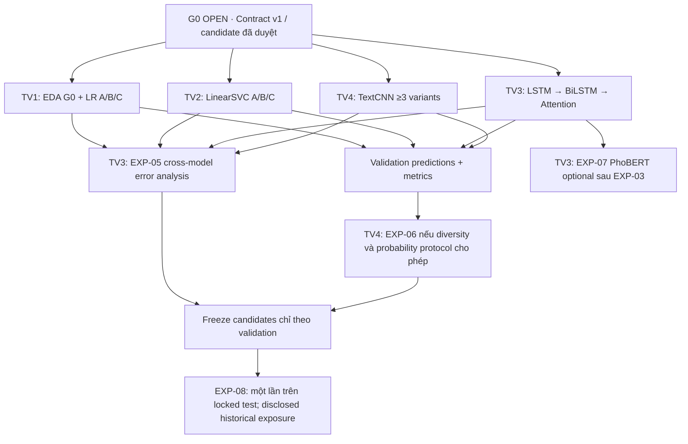

# TODO nhóm — Vietnamese Toxic Comment Detection

Checklist theo thành viên: [Tam (TV1)](TV1.md) · [Vinh (TV2)](TV2.md) · [Huy (TV3)](TV3.md) · [TheAnh (TV4)](TV4.md).

**Protocol hiện hành D1–D4:** ViHSD và ViCTSD dự kiến gộp thành `0=CLEAN`, `1=TOXIC`, có `source`, dedupe trước split 70/15/15 theo `(source,label)`. Split mới chưa được dựng; quyền UIT và khác biệt định nghĩa nhãn còn chờ xác nhận. Chọn checkpoint bằng val Macro-F1; calibration và threshold trên val. Freeze mọi candidate trước một đợt locked test, công bố lịch sử test exposure.

PhoBERT là benchmark pretrained fine-tune, do Huy phụ trách và chờ xác nhận giảng viên. Huy phụ trách N3, N4, N5, N8, N9, N11 và N12; xem [checklist chung](../../tasks/todo.md). Deadline chưa xác định.

Các mục `[x]` trong checklist cá nhân được giữ làm lịch sử, không chứng minh đã hoàn thành trên split nhị phân.
## Lịch sử G0 trước D1–D4

## Audit hiện trạng

| Phần | Trạng thái thực tế | Bằng chứng / việc còn lại |
|---|---|---|
| Data Contract / EXP-00 (TV3) | **Đã duyệt; G0 OPEN** | Contract v1, G0 acceptance và `vihsd_g0_v1` có hash/manifest, split checks PASS. Official training được mở. |
| EXP-01 (TV1) | **Đã có EDA và 3 LR artifacts trên dữ liệu cũ; chưa nghiệm thu trên G0** | Notebook/config/artifacts trỏ `data/processed/vihsd.jsonl`; run ghi 24,048 train / 2,672 val thay vì candidate hiện hành 23,002 / 4,929. Cần cập nhật EDA và chạy lại A/B/C; không dùng số cũ như kết quả official. |
| EXP-02 (TV2) | **Chưa bắt đầu** | Không thấy pipeline/config/results riêng cho LinearSVC. Có TF-IDF utility dùng chung nhưng không chứng minh đã có SVM experiment. |
| EXP-03 (TV3) | **Hạ tầng và fixture tests đã có; official training chưa được chứng minh** | Recurrent model/trainer/checkpoint/loader/report có sẵn; official driver/config hiện có. Chưa thấy official checkpoints, run metrics hay prediction artifacts. |
| EXP-04 (TV4) | **Chưa bắt đầu** | Không thấy TextCNN code/config/tests/metrics/checkpoints riêng. |
| EXP-05 (TV3) | **Chưa bắt đầu** | Chưa có cross-model validation predictions/error report. |
| EXP-06 (TV4) | **Chưa bắt đầu; conditional** | Chưa có prediction diversity evidence từ ≥2 models; chỉ tiếp tục nếu có căn cứ. |
| EXP-07 (TV3) | **Chưa bắt đầu; optional** | Không thấy PhoBERT training/artifacts; chỉ sau nghiệm thu EXP-03 scratch. |

## Blockers, giới hạn và tài liệu không đồng bộ

- **Không có blocker G0 cho việc bắt đầu train official:** Gate OPEN. TV1’s legacy artifacts cần được chạy lại, nhưng **không được để TV1 EDA chặn** TV2–TV4; các nhánh có thể code/run độc lập trên shared contract.
- G0 acceptance ghi UIT original permission chưa xác minh, near-duplicate/thread leakage chưa chứng nhận, và test mới có historical exposure; đây là giới hạn cần công bố. Không tuyên bố test blind hoặc public redistribution được phép.
- `docs/G0_TV1_REVIEW_CHECKLIST.md` và phần trạng thái cũ trong `docs/tv1_g0_report.md` mô tả G0 pending; đó là lịch sử trước review/duyệt. Dùng `docs/TEAM_WORK_CONTEXT.md`, `docs/DATA_CONTRACT_v1.md`, `docs/G0_FINAL_REVIEW.md` cho hiện trạng. `tasks/todo.md`/`tasks/plan.md` là checklist kế hoạch, không phải evidence hoàn thành. Một số tài liệu còn mô tả plan-only/implementation not started; đối chiếu source/artifacts thực tế trước khi đổi trạng thái.
- Các LR run IDs hiện nằm trong artifacts, nhưng repository snapshot không có thư mục `mlruns/`; khả năng mở lại các run trong MLflow chưa được xác minh. TV1 cần giữ/đưa ra tracking evidence khi chạy lại.

## Thứ tự triển khai và dependency

- **Song song ngay:** bốn EXP-01…04. TV1 làm EDA và sửa pipeline/rerun; TV2/TV4 xây nhánh riêng; TV3 đồng bộ contract và chạy recurrent. TV2–TV4 không phụ thuộc kết quả EDA chi tiết của TV1.
- **Resource coordination:** LR/SVM chủ yếu CPU; nếu dùng chung GPU, xếp lịch recurrent/TextCNN, rồi PhoBERT sau scratch. Không chạy hai job DL lớn đồng thời trên GPU giới hạn.
- **Sau run:** các TV xuất validation predictions → TV3 chủ trì EXP-05; TV4 quyết định EXP-06 chỉ khi predictions cho thấy lỗi bổ sung; TV3 freeze candidates trên validation → EXP-08 one-shot (TV1 điều phối theo experiment plan).
- **Không chặn final:** PhoBERT và ensemble là tùy chọn; RBF SVC tùy ngân sách. Không mở locked test để giải quyết bất kỳ thiếu hụt development nào.

## Cách cập nhật checklist

Mỗi task dùng checkbox chưa chọn cho việc còn phải làm; trạng thái snapshot ở đầu file ghi phần đã có/đang dở/bị chặn. Chỉ đánh dấu hoàn tất khi đầu ra và tiêu chí nghiệm thu có evidence; không chuyển fixture smoke, code hiện diện hay số liệu cũ thành official result.
